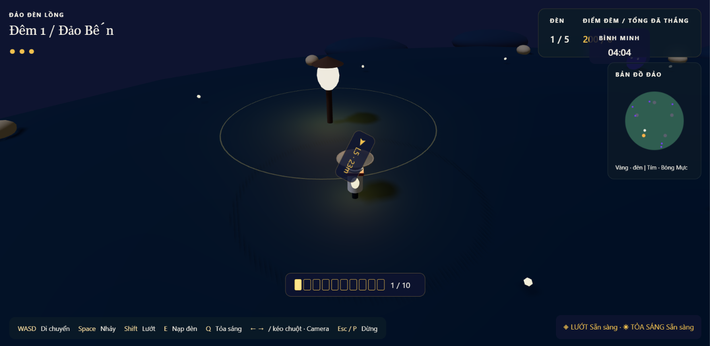

# Đảo Đèn Lồng — v1.0.0 / Phase 4

**Video demo:** chưa có file MP4 được quay và xác nhận. Game có nút quay màn hình trong Cài đặt; hướng dẫn ở bên dưới.

Game 3D góc nhìn thứ ba: Mây gom đom đóm, châm dầu và giữ đảo sáng tới bình minh qua ba Đêm. Contract **v1.3**, giữ luật nhiên liệu Phase 3.



## Yêu cầu hệ thống

- Node.js 20 trở lên, npm; Windows, macOS hoặc Linux.
- Trình duyệt desktop hỗ trợ WebGL 2, bàn phím/chuột, tăng tốc GPU.
- Cần Internet khi cài dependency; sau cài, game dùng Three.js cục bộ, không có CDN.
- Benchmark cần Chromium/Chrome/Edge và GPU thật. Docker là phương án đóng gói bổ sung; máy hiện tại chưa có Docker để xác nhận build image.

## Cài và chơi — 2 lệnh

Sau khi clone repo hoặc giải nén ZIP phát hành, mở terminal trong thư mục dự án:

```sh
npm ci
npm start
```

Mở **http://127.0.0.1:5173**. Dừng server cũ trước khi khởi động bản mới. Settings lưu ở trình duyệt; bảng điểm lưu trên đĩa ở data/leaderboard.json.

Docker, nếu đã cài Docker:

```sh
docker build -t dao-den-long .
docker run --rm -p 5173:5173 -v lantern-data:/app/data dao-den-long
```

## Điều khiển và dễ tiếp cận

Mặc định: WASD di chuyển, Space nhảy, Shift trái lướt, E tương tác, Q tỏa sáng, Esc tạm dừng. Kéo chuột hoặc mũi tên trái/phải xoay camera.

Trong **Cài đặt**: đổi từng phím, phát hiện trùng và khôi phục mặc định; âm lượng/độ nhạy, màu dễ phân biệt, giảm chuyển động và chữ lớn ×1,25. Các tùy chọn được lưu. Cỡ chữ UI mục tiêu tối thiểu18px ở1280×720. Chỉ báo hình ảnh cho shade xuất hiện, gió,10giây cuối và đèn ít dầu; không cần nghe âm thanh để nhận cảnh báo.

## Luật và điểm

Đêm1/2/3 dài240/270/300giây. Cần còn sống và giữ ít nhất3/5,4/6,5/7đèn sáng tại bình minh; không thắng sớm. Đèn có100dầu, hao1/giây, dưới30 mất vùng an toàn và có thể bị shade hút5/giây/con.

Thắp mới cần10đom đóm, thắp lại5; mỗi đom đóm châm thêm10dầu. Sức chứa bắt đầu10, tăng2 mỗi lần thắp thành công, tối đa20. Điểm: nạp/châm+5/mote; thắp đầu+100, thắp lại+40; pulse+5/shade hoặc tổng+15 nếu đang drain. Khi thắng: mỗi đèn sáng+50+floor(fuel), mỗi lửa+50. Tổng chỉ cộng các Đêm đã thắng.

## Bảng xếp hạng

Sau thua bất kỳ Đêm nào hoặc sau Bình Minh Đêm3, nhập tên3–12ký tự A–Z/a–z/0–9/_ để lưu. Mục lưu đúng tổng điểm đã thắng, số đêm thắng, thời gian ISO có múi giờ và seed. Top10 sắp điểm giảm dần, hòa điểm thì đạt trước đứng trước. Mở từ nút Bảng xếp hạng trong menu.

Xuất cùng dữ liệu mà game đang dùng:

```sh
node scripts/serve.mjs --export-leaderboard out.json
```

Có thể đặt LANTERN_DATA_DIR để đổi thư mục dữ liệu. Không commit dữ liệu bảng điểm cá nhân.

## Kiểm chứng và headless

```sh
npm run check
node src/headless/cli.mjs --seed 123 --night 2 --ticks 1200 --out output.jsonl
```

Headless không cần cửa sổ/GPU; thêm --scenario, --inputs, --snapshot-every. Lỗi JSON/schema mã2, lỗi lệnh/I/O mã1, thành công mã0. Pause tăng tick, không tăng sim_tick. Các luật bị thay và lý do cập nhật test: [CHANGELOG](CHANGELOG.md), [ADR](docs/decisions/ADR-003-lantern-fuel.md).

## Benchmark chuẩn v1.3

```sh
npm run bench -- --seed 42 --duration 30 --out bench.json
```

Lệnh mở cửa sổ Chromium/Edge1280×720 (hoặc in URL nếu không tìm thấy trình duyệt; có thể đặt LANTERN_BROWSER). Cảnh đúng200shade wander,100mote,3đèn sáng100dầu, không nhặt/hit/hao/spawn/kết thúc; camera vòng30m/Y15,15giây/vòng. Bỏ3giây đầu, đo30giây và ghi report rồi kết thúc lệnh.

**Web không thể tắt vsync do trình duyệt quản lý:** vsync_off=false. Trang web không đo được RSS tiến trình nên peak_mem_mb=null, không dùng JS heap thay RSS. avg_fps,1%low và p95 tính từ dt khung thật; p95 dùng nearest-rank; phần giao tại biên khoảng đo được cắt theo cửa sổ đo chính xác. load_ms từ lúc tiến trình Node bắt đầu tới frame scene đầu tiên.

Ngưỡng trên máy chấm: avg_fps>=60, p1_low_fps>=30, load_ms<=10000. **Chưa có bench.json đo GPU được xác nhận trong môi trường công cụ; không coi unit test metric là kết quả benchmark đạt.**

## Soak test

```sh
npm run soak -- --seed 7 --nights 10 --out soak.json
```

Một tiến trình,10Đêm xoay1→2→3, seed7+i với i=0…9. Đổi hướng mỗi30tick, input nhảy5%/dash3%/pulse2%/interact10% mỗi tick. RSS đo bằng process.memoryUsage().rss sau tải Đêm đầu và sau dọn/reset Đêm cuối; dùng --expose-gc để GC ranh giới reset. Xem [bằng chứng Phase4](docs/proof/phase-4/checklist.md). Tất cả lượt có thể thua; soak kiểm tra crash/bộ nhớ, không yêu cầu thắng.

## Quay demo dưới 5 phút

Cài đặt → **Quay demo màn chơi**, chọn màn hình/cửa sổ cần chia sẻ. Dừng từ thanh chia sẻ hoặc nút trong game. Tự dừng sau4phút50giây. Nếu trình duyệt hỗ trợ MediaRecorder MP4 sẽ tải demo.mp4; nếu chỉ hỗ trợ WebM, chuyển bằng FFmpeg:

```sh
ffmpeg -i demo.webm -t 290 -c:v libx264 -crf 24 -c:a aac demo.mp4
```

Quay chơi thật, kết quả test và benchmark; đính kèm MP4 vào Release v1.0.0 rồi thay dòng video đầu README bằng link thật. Không dùng ảnh tĩnh hoặc output chỉnh tay thay video.

## Đóng gói và tình trạng phát hành

```sh
npm run package
```

Tạo artifacts/dao-den-long-v1.0.0.zip và SHA256. Gói gồm mã, lockfile, Dockerfile, giấy phép và tài liệu; không chứa .env, node_modules, .git hoặc dữ liệu bảng điểm. Sau giải nén cài/chạy bằng2lệnh ở trên.

[Checklist phát hành](docs/proof/phase-4/checklist.md) phân biệt phần đã đo với mục còn chờ. Chưa xác nhận toàn bộ UI/benchmark/video trên trình duyệt vì browser access host unavailable. Không tuyên bố đạt mọi test ẩn.

## Nguồn và ghi chép

[LICENSE](LICENSE), [CREDITS](CREDITS.md), [harness](AGENTS.md), [retro](docs/notes/retro.md). Các ý hình học/âm thanh thủ tục không thêm thực thể sáng tạo trong headless; benchmark tắt các trang trí bổ sung. Cây/mây/chi tiết ngoài luật không thay output chấm.

B?n ZIP Release ?? k?m Three.js v? gi?y ph?p: gi?i n?n, d?ng Node 24 ch?y `node scripts/serve.mjs`, m? http://127.0.0.1:5173. Kh?ng c?n t?i dependency ?? ch?i t? ZIP. Clone repo v?n d?ng hai l?nh npm ci v? npm start. B? ghi demo t? ??ng: `node scripts/demo.mjs --seed 12 --duration 75 --out artifacts/demo.mp4` (MP4 MediaRecorder tr?n Edge/Chrome).
